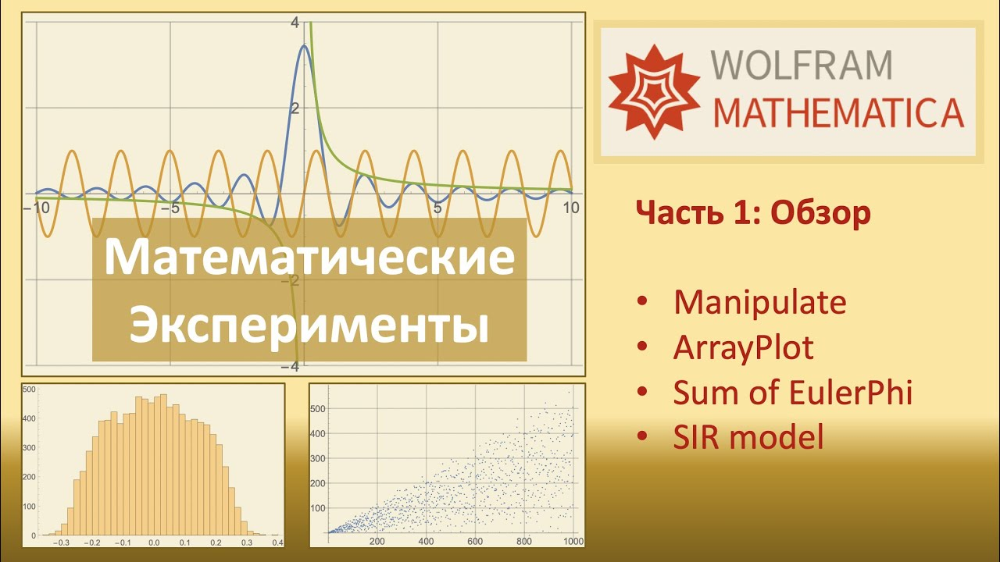

# 001. 1. Знакомство с Wolfram Mathematica. "Галопом по Европе" (English subtitles)

[English](README.md) · [Видео на YouTube](https://www.youtube.com/watch?v=2bCv1CFKGr4)

## Материалы

- [Русский тайтл](title.ru.txt) · [описание](description.ru.md)
- [Английский тайтл](title.en.txt) · [описание](description.en.md)
- [Теги YouTube](tags.json): общие для видео, без независимых языковых списков
- [Русские субтитры](captions/ru.vtt) · [английские субтитры](captions/en.vtt)

## Notebooks Mathematica

- [001-review.nb](../../yt-channel/001-review.nb)
