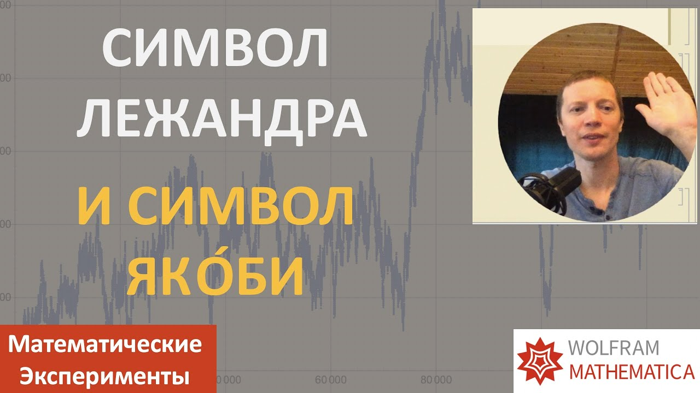

# 006. 6. "Положительные" числа в модульной арифметике. Символ Якоби. Квадратичное расширение (eng. subs.)

[English](README.md) · [Видео на YouTube](https://www.youtube.com/watch?v=dB6OrpgN78s)

## Материалы

- [Русский тайтл](title.ru.txt) · [описание](description.ru.md)
- [Английский тайтл](title.en.txt) · [описание](description.en.md)
- [Теги YouTube](tags.json): общие для видео, без независимых языковых списков
- [Русские субтитры](captions/ru.vtt) · [английские субтитры](captions/en.vtt)

## Notebooks Mathematica

- [005-legendre.nb](../../yt-channel/005-legendre.nb) — related companion; exact source not located

Точный исходный notebook для этой записи пока не найден. Приведены только явно помеченные материалы по близкой теме.
