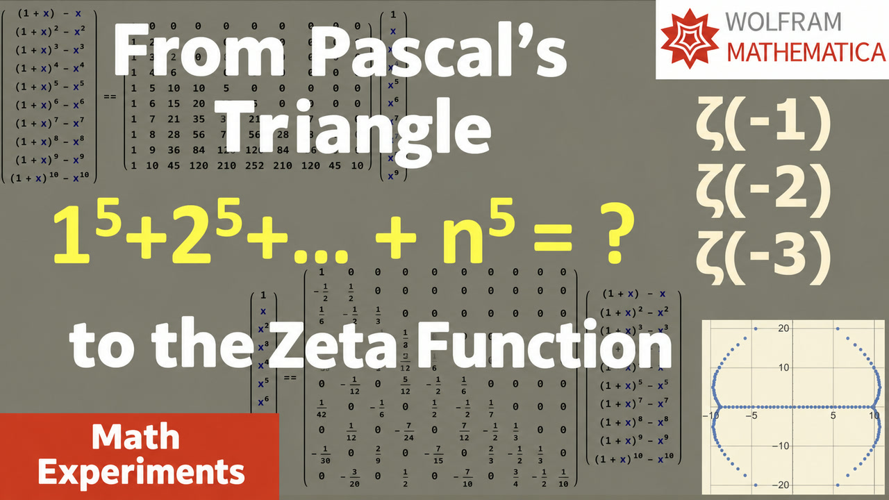

# 008. 8. From Pascal's Triangle to Zeta-function (English subtitles)

[Русский](README.ru.md) · [Watch on YouTube](https://www.youtube.com/watch?v=knsPidrHZDo)

## Metadata

- [English title](title.en.txt) · [description](description.en.md)
- [Russian title](title.ru.txt) · [description](description.ru.md)
- [Current global YouTube tags](tags.json)
- [English subtitles](captions/en.vtt) · [Russian subtitles](captions/ru.vtt)
- [Machine-readable video record](video.json)

## Mathematica notebooks

- [012-sin-zeta.nb](../../yt-channel/012-sin-zeta.nb) — related companion; exact source not located

The exact notebook source for this recording has not been located. Related files above are explicitly marked and should not be mistaken for the exact source.

## Editable thumbnail source

- [PowerPoint](../../thumbnail-sources/pictures-4.ru.pptx) — slide 3
