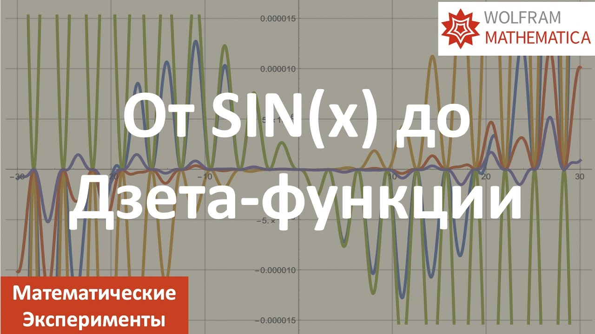

# 012. 12. От sin(x) до значений дзета функции ζ(-1), ζ(-2), ... (часть 1)

[English](README.md) · [Видео на YouTube](https://www.youtube.com/watch?v=O5yT6DGvcZI)

## Материалы

- [Русский тайтл](title.ru.txt) · [описание](description.ru.md)
- [Английский тайтл](title.en.txt) · [описание](description.en.md)
- [Теги YouTube](tags.json): общие для видео, без независимых языковых списков
- [Русские субтитры](captions/ru.vtt) · [английские субтитры](captions/en.vtt)

## Notebooks Mathematica

- [012-sin-zeta.nb](../../yt-channel/012-sin-zeta.nb)
