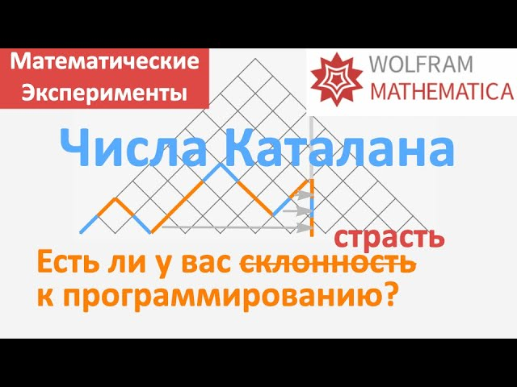

# 021. 21. Числа Каталана. Тестируем страсть к программированию (English subtitles)

[English](README.md) · [Видео на YouTube](https://www.youtube.com/watch?v=zNNWmJF46rE)

## Материалы

- [Русский тайтл](title.ru.txt) · [описание](description.ru.md)
- [Английский тайтл](title.en.txt) · [описание](description.en.md)
- [Теги YouTube](tags.json): общие для видео, без независимых языковых списков
- [Русские субтитры](captions/ru.vtt) · [английские субтитры](captions/en.vtt)

## Notebooks Mathematica

- [021-catalan_numbers.nb](../../yt-channel/021-catalan_numbers.nb)
