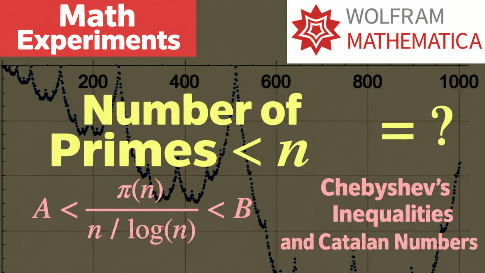

# 022. 22.  Distribution of Prime Numbers and Catalan Numbers. Chebyshev's Inequalities (English subtitles)

[Русский](README.ru.md) · [Watch on YouTube](https://www.youtube.com/watch?v=VeLbvkEJrn0)

## Metadata

- [English title](title.en.txt) · [description](description.en.md)
- [Russian title](title.ru.txt) · [description](description.ru.md)
- [Current global YouTube tags](tags.json)
- [English subtitles](captions/en.vtt) · [Russian subtitles](captions/ru.vtt)
- [Machine-readable video record](video.json)

## Mathematica notebooks

- [022-catalan_chebychev.nb](../../yt-channel/022-catalan_chebychev.nb)

## Editable thumbnail source

- [Keynote](../../thumbnail-sources/022.ru.key)
