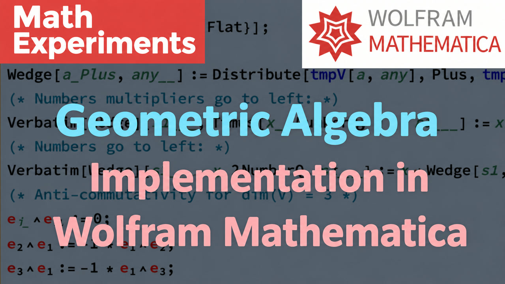

# 023. 23. Geometric Algebra.  Maxwell equation in one line (English Subtitles)

[Русский](README.ru.md) · [Watch on YouTube](https://www.youtube.com/watch?v=Nl3nYVMnn44)

## Metadata

- [English title](title.en.txt) · [description](description.en.md)
- [Russian title](title.ru.txt) · [description](description.ru.md)
- [Current global YouTube tags](tags.json)
- [English subtitles](captions/en.vtt) · [Russian subtitles](captions/ru.vtt)
- [Machine-readable video record](video.json)

## Mathematica notebooks

- [023-geometric_algebra.nb](../../yt-channel/023-geometric_algebra.nb)
- [GA.nb](../../yt-channel/GA.nb)

## Editable thumbnail source

- [Keynote](../../thumbnail-sources/023.ru.key)
